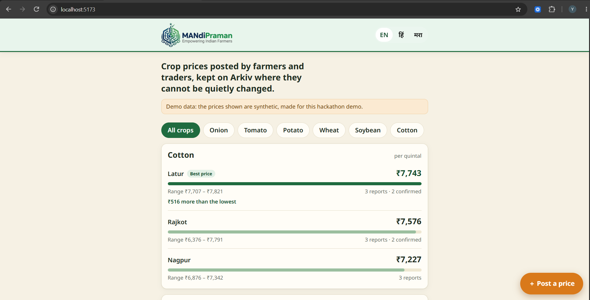
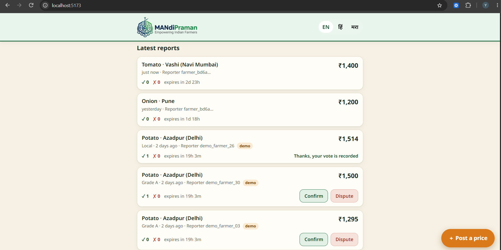
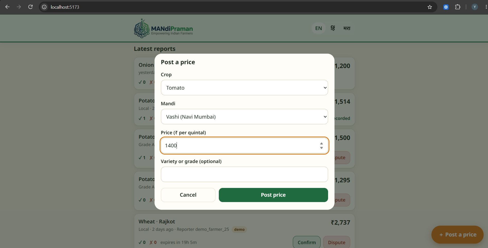
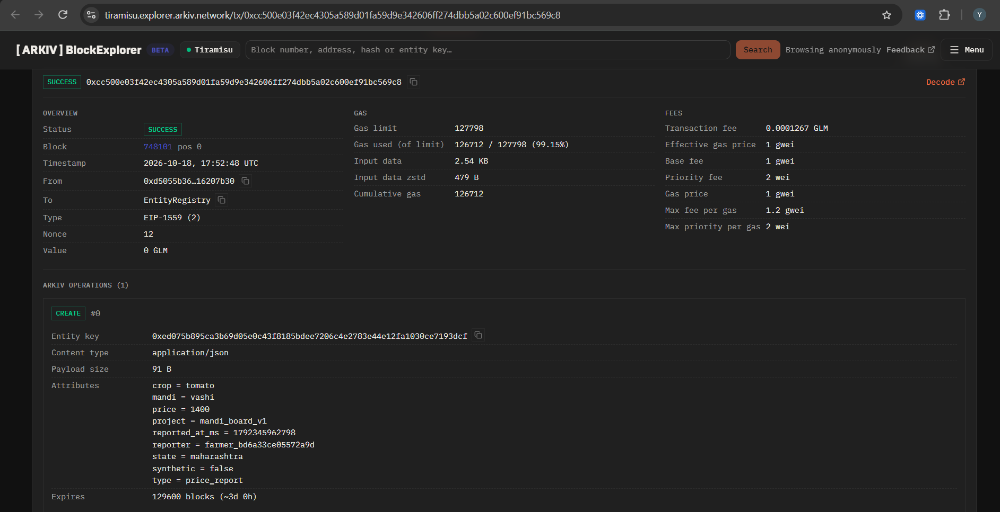
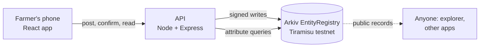

# Mandi Praman

**Crop prices from Indian mandis, posted by farmers and traders, and kept on Arkiv where they are frozen once posted.**

<!--
  SCREENSHOTS: save your images in docs/images/ with these exact names and they will appear here.
    docs/images/dashboard.png   the price board (best mandi highlighted)
    docs/images/reports.png     latest reports with Confirm / Dispute
    docs/images/post-price.png  the "Post a price" sheet (or the app in Hindi)
  Phone-sized screenshots (about 390 x 844) look best. Delete this comment when done.
-->

  
  
  
  

## Why Mandi Praman

*Praman* (प्रमाण) means proof, or evidence, in Hindi and Marathi. The name is the idea: a crop price you can point to, because nobody can quietly rewrite it.

## The problem

A farmer deciding where to take a load of onions today often hears the price from the buyer or a commission agent, who may gain from quoting a low number. Official price sources exist, but they are not always easy to use on a phone, in a regional language, at the moment of decision. And any price list that lives in one party's database can be edited or deleted without anyone noticing.

So the farmer is left comparing a number they cannot check against a number they cannot compare.

## What it does

- **Anyone can post a price** for a crop at a mandi. No account and no crypto wallet.
- **Others confirm or dispute it.** A report is left out of the price only when it has been clearly rejected: at least two disputes, and more disputes than confirmations.
- **The board shows the median** of the trusted recent reports for each crop and mandi, so a single wrong number cannot move it. The best mandi is highlighted, with how much more it pays than the lowest.
- **Old prices disappear on their own.** Reports expire (after 72 hours by default), so the board shows what is current.
- **Three languages:** English, Hindi and Marathi.
- **Every action can be checked.** After posting or voting, the app links to the transaction on the Arkiv explorer.

All prices shown in the demo are synthetic test data, and the app says so.

## Why Arkiv

Mandi Praman needs four things from its database, and Arkiv provides them directly:

| Need | How Arkiv covers it |
| --- | --- |
| Prices nobody can quietly edit | Every report and vote is created with the `readonly` flag, so its contents can never be patched, even by the app's own wallet. A delete is possible, but it is a public transaction anyone can see in the explorer. |
| Fast filtering without running an indexer | Crop, mandi, state, price and time are stored as typed attributes and queried directly (`eq`, range queries on `dec` and `u64` values). There is no separate subgraph or search service to keep in sync. |
| Stale prices removed automatically | Each entity has an expiry. A vote expires with the report it points to. There is no cleanup job. |
| Open data | The records are public. Another app can read the same prices from the chain without asking us for API access. |

**What is deliberately kept off Arkiv:** the computed median (it is derived, and storing it would create a second, stale source of truth), any user identity or phone number, the Hindi and Marathi names (static app data), photos, and all keys and secrets. The only per-user value stored is a random pseudonymous id.

The full entity design is in [`arkiv/schema.md`](arkiv/schema.md). Notes from building on the network are in [`arkiv/friction.md`](arkiv/friction.md).

## How it is built

- **Frontend:** React, TypeScript and Vite, with TanStack Query for data fetching. Mobile-first, three languages, refreshes every 20 seconds.
- **Backend:** Node, Express and TypeScript, using the Arkiv TypeScript SDK (`@arkiv-network/sdk` 0.8) and `viem`. It validates input, signs writes with a relayer wallet, rate-limits submissions, and caches reads briefly because the public RPC is rate limited.
- **Data:** two entity types, `price_report` and `price_vote`, linked by a `key` attribute. Prices are stored as `dec` and timestamps as `u64` so both can be range-queried.
- **Median and trust rule:** computed in the backend from the entities returned by the query.

### A deliberate trade-off: the relayer

Farmers do not have crypto wallets or testnet tokens. So one server-side relayer wallet signs and pays for every write, and each browser holds a random pseudonymous id so that people cannot vote on their own report or vote twice. This keeps the app usable today. It also means submission is centralised, even though the stored records are not.

## Honest limitations

- The relayer wallet is a single point of submission, and as the owner of the entities it could delete one (publicly).
- Pseudonymous ids are not Sybil-resistant. The median limits the damage of one bad report, but a coordinated group could still skew it.
- Prices are crowd-reported and are not checked against official sources.
- It runs on a testnet with synthetic demo data.

## What could come next

These are ideas, not features of the current version:

- Per-user wallets or account abstraction, so users own what they post and the relayer is not needed.
- WhatsApp, SMS or voice entry for people who find a web form hard to use.
- A reference line from official mandi data, to compare against crowd reports.
- More crops, mandis and languages.

## Built for

The Arkiv × Devcon 8 pre-Devcon challenge (9 to 18 October 2026), built during the challenge window.

Tracks entered: Best Indian Use Case, and Censorship Resistance.

Running it yourself: see [`docs/SETUP.md`](docs/SETUP.md).

## License

MIT. See [LICENSE](LICENSE).